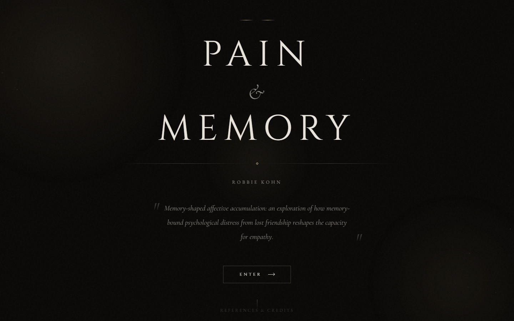
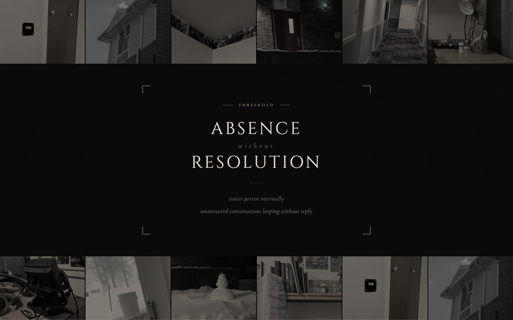
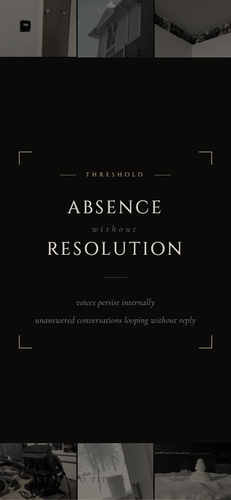
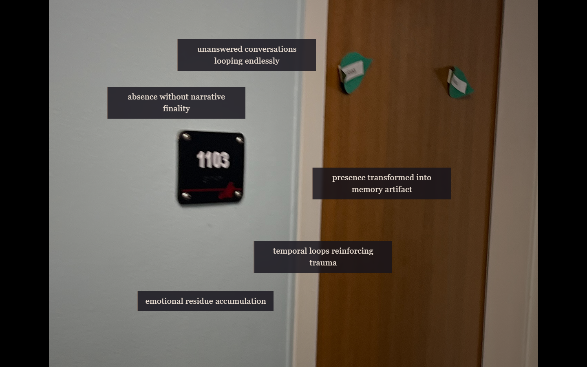
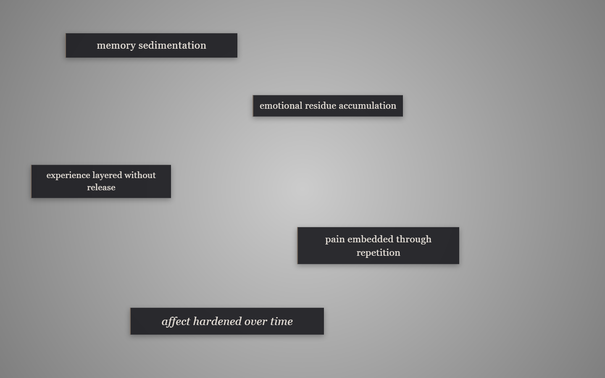
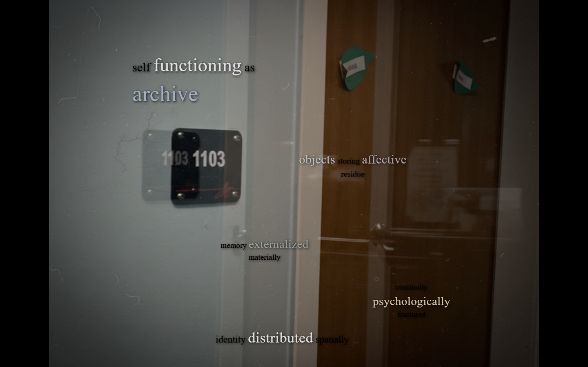

# Pain and Memory: An Interactive Web Installation

Selected HTML, CSS, and web development coursework completed by **Robert Kohn** at Muhlenberg College for **COM 256: Introduction to Interactive Web Design** (Spring 2026). 

This repository presents ***Pain and Memory: Memory-Shaped Affective Accumulation***, a non-linear hypermedia web installation exploring how memory-bound psychological distress from lost friendship reshapes the capacity for empathy. The project translates narrative concepts of grief, time loops, and absence into an explorable digital environment built with semantic HTML5, responsive CSS layout systems, interactive image maps, procedural canvas physics, and a graph-based hyperlinking matrix.

---

## Visual Overview

<p align="center">
  
</p>

---

## Highlights

### 1. Title & Experience Gateway (`index.html`)
The gateway to the installation features high-craft editorial typography (*Cinzel*, *Cormorant Garamond*, *EB Garamond*), subtle ambient radial lighting drift, an SVG fractal noise grain texture, and an interactive 2D physics particle field.

- **Canvas 2D Particle Simulation**: A lightweight particle engine running on an HTML5 `<canvas>` simulating floating dust/light motes with individual velocities, random lifespans, alpha decay, and boundary wrapping.
- **Mouse Parallax Depth**: A custom JavaScript easing engine that calculates cursor displacement relative to the viewport center and subtly offsets text layers according to depth coefficients.
- **Modal Portal Launcher**: Dynamic windowing script calculating center-screen coordinates to launch the navigation threshold interface.

---

### 2. The Navigation Portal (`portal.html`)
The primary navigation nexus connecting the installation's spatial and textual environments.

<p align="center">
  
</p>

- **Dual-Ribbon Grid**: Twelve spatial cells arranged into top and bottom 6-column ribbons featuring grayscale-to-color hover transitions, subtle scaling, and Roman numeral cell labels.
- **Responsive Layout Collapse**: Fluid CSS Grid that collapses from 6 columns on desktop to 4 on tablet and 3 on mobile viewports.
- **Inactivity Countdown Timer**: A 15-second visual countdown progress bar that tracks user inactivity and automatically resets upon `mousemove`, `keydown`, or `click` events.
- **Corner-Bracketed Card Architecture**: Custom CSS hairline bracket geometry framing the central "Threshold: Absence without Resolution" card.

<p align="center">
  
  <br>
  <em>Mobile responsive view demonstrating 3-column grid collapse.</em>
</p>

---

### 3. Phase 1: Alpha Spatial & Layout Studies (`alpha/`)
The foundational tier establishing the spatial coordinates and modular CSS layout architecture.

<p align="center">
  
</p>

- **Polygonal Responsive Image Maps (`alpha/image/`)**: 10 spatial nodes mapping photographic scenes using HTML `<map>` and `<area shape="poly">` hot spots, scaled dynamically via `jquery.rwdImageMaps`.
- **Atmospheric Text Overlays (`alpha/imagine/`)**: 10 photographic scenes with radial gradient contrast vignettes and glassmorphic text containers (`backdrop-filter: blur(3px)` with warm borders).
- **Consolidated 7-Class Layout System (`alpha/text/design.css`)**: Refactored from ten repetitive single-file stylesheets into a single stylesheet defining 7 spatial layout archetypes (`scattered`, `corridor`, `spiral`, `diagonal`, `loop`, `hinge`, `default`).

<p align="center">
  
</p>

---

### 4. Phase 2: Beta Advanced Hypertext & Typographic Kernels (`beta/`)
The advanced evolution of the hypermedia installation, refining spatial imagery into high-resolution fixed-stage viewports and transitioning from card containers to floating text kernels.

<p align="center">
  
</p>

- **Typography-First Kernel Design (`beta-text-design.css`)**: Completely discards opaque boxes in favor of ethereal text phrases floating over dark photographic backgrounds with layered drop shadows.
- **Hierarchical Weight & Chromatic Scale**: Multi-tier typography classes (`.emph`, `.emph-more`) paired with a 6-tone muted palette (`.color-1` through `.color-6`).
- **Ten Thematic Chapters**:
  1. `archive_self.html`: The human subject functioning as an archive of past attachment
  2. `caregiving_labor.html`: Vulnerability, relational exposure, and care under duress
  3. `endurance_survival.html`: Psychological survival through sustained grief
  4. `ethical_repetition.html`: Repetition as moral obligation and prolonged empathy
  5. `friendship_decay.html`: Entropy and communicative silence in broken relationships
  6. `memory_tyranny.html`: The oppressive persistence of involuntary recall
  7. `pain_expression.html`: The difficulty and inadequacy of linguistic expression for internal pain
  8. `relational_pain.html`: Trauma transmitted relationally between individuals
  9. `sensory_memory.html`: Physical artifacts retaining emotional residue
  10. `temporal_dissonance.html`: Past events distorting the perception of present time

---

### 5. Hypermedia Routing Architecture (`kohn_EMATRIX.csv`)
An architectural graph specification defining the five outbound hyperlink pathways from each node across all four spatial quadrants (`alpha/image`, `alpha/text`, `beta/image`, `beta/text`), demonstrating intentional structural planning for non-linear digital narratives.

---

### 6. Media Context & References (`credits.html`)
Academic contextualization and bibliography citing 10 narrative media texts exploring memory, trauma, and identity (*Re:Zero*, *Steins;Gate*, *Erased*, *3-Gatsu no Lion*, *Angel Beats!*, *Plastic Memories*, *Bocchi the Rock!*, *BanG Dream! It's MyGO!!!!! / Ave Mujica*, *My Teen Romantic Comedy SNAFU*, *Charlotte*).

---

## Skills Demonstrated

| Category | Skills & Techniques |
| :--- | :--- |
| **HTML5** | Semantic markup, document head metadata, HTML `<map>` and `<area shape="poly">` coordinate mappings, SVG filter overlays, relative path structures. |
| **CSS3** | CSS Custom Properties, CSS Grid, Flexbox, fluid typography via `clamp()`, `backdrop-filter: blur()`, CSS keyframe animations, CSS consolidate refactoring. |
| **JavaScript** | HTML5 Canvas 2D API (particle physics), event listeners (`mousemove`, `keydown`, `click`), smoothed mouse parallax, DOM timers, windowing APIs. |
| **UX & Hypermedia** | Non-linear graph navigation, bottom-up exploratory design, visual-textual spatial anchoring, state preservation. |
| **Code Quality** | Zero broken links across 50+ documents, case-normalized file naming for cross-platform compatibility, removal of instructor boilerplate. |

---

## Repository Structure

```
.
├── .gitignore                      # Standard web portfolio ignore rules
├── README.md                       # Repository overview and documentation
├── COURSEWORK_REVIEW.md            # Detailed academic audit report
├── index.html                      # Title gateway: Canvas particles & mouse parallax
├── portal.html                     # Central navigation portal: Dual ribbons & timer
├── credits.html                    # Narrative bibliography & academic context
├── kohn_EMATRIX.csv                # 5-way hypermedia routing matrix
├── assets/
│   └── screenshots/                # Real webpage renders and mobile views
├── alpha/                          # Phase 1: Spatial & layout studies
│   ├── README.md                   # Alpha phase documentation
│   ├── image/                      # 10 polygonal responsive image maps + index gallery
│   ├── imagine/                    # 10 photographic scenes with glassmorphic overlays
│   └── text/                       # 10 layout nodes + consolidated design.css (7 classes)
└── beta/                           # Phase 2: Advanced hypertext & kernels
    ├── README.md                   # Beta phase documentation
    ├── image/                      # 10 fixed-stage 1200x900 viewports (3600x2700 photography)
    ├── imagine/                    # 10 atmospheric text kernel scenes with return routes
    └── text/                       # 10 thematic chapters + beta-text-design.css system
```

---

## Running Locally

The installation consists of standard static HTML, CSS, JavaScript, and image assets. No compilation, package manager, or server runtime is required.

1. **Clone the repository:**
   ```bash
   git clone https://github.com/rkohnmn/pain-memory.git
   cd pain-memory
   ```

2. **Open in browser:**
   Open [`index.html`](file:///c:/Users/RobTop/Downloads/project%20-%20kohn%20robbie-20261001T003143Z-1-001/project%20-%20kohn%20robbie/github-html-coursework/index.html) directly in any modern desktop browser (Chrome, Firefox, Safari, Edge).

3. *(Optional)* **Run via local development server:**
   ```bash
   # Using Node.js
   npx serve .

   # Or using Python 3
   python -m http.server 8000
   ```
   Navigate to `http://localhost:8000` or the port shown.

---

## About the Author

**Robert Kohn**  
Senior at Muhlenberg College  
Triple-Major: Mathematics, Statistics, and Physics  
GitHub: [@rkohnmn](https://github.com/rkohnmn) • [LinkedIn](https://www.linkedin.com/in/robert-kohn-844573345/)
