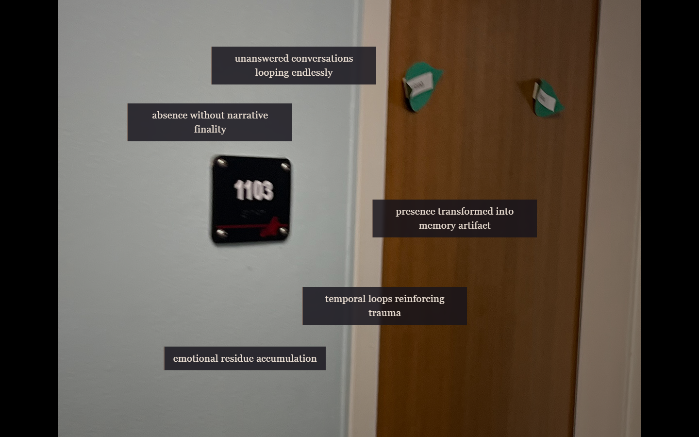
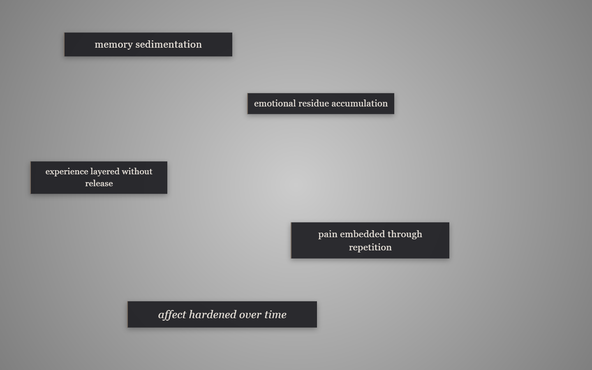

# Phase 1: Alpha Spatial & Layout Studies

A spatial hypermedia exploration completed for **COM 256: Interactive Web Design** at Muhlenberg College. This phase establishes the initial spatial architecture and CSS layout patterns for the *Pain and Memory* installation.

  

## Visual Designs

  

## What I Built

- **Polygonal Responsive Image Maps (`image/`)**: Interactive spatial nodes mapped over 1200×900 architectural photographs using HTML `<map>` and `<area shape="poly">` elements, synchronized dynamically with responsive viewports via the `jquery.rwdImageMaps` plugin.
- **Atmospheric Text Overlays (`imagine/`)**: Ten photographic backdrops overlaid with radial gradient vignettes and semi-transparent, glassmorphic text containers (`backdrop-filter: blur(3px)` with warm border accents) that anchor poetic fragments in visual space.
- **Consolidated Layout System (`text/`)**: A modular CSS stylesheet ([`design.css`](file:///c:/Users/RobTop/Downloads/project%20-%20kohn%20robbie-20261001T003143Z-1-001/project%20-%20kohn%20robbie/github-html-coursework/alpha/text/design.css)) refactored from ten repetitive single-file stylesheets into seven reusable layout classes.
- **Gallery Index (`image/index.html`)**: A dark-mode grid gallery listing all Alpha fragments with hover-state transitions.

## Technologies

- **HTML5**: Semantic markup, `<map>` and `<area>` coordinate mappings, document structure.
- **CSS3**: Custom positioning, CSS `clamp()` fluid typography, Flexbox, CSS Grid, `backdrop-filter`, radial gradients, transitions, and hover states.
- **JavaScript & jQuery**: jQuery 1.10.2, Matt Stow's Responsive Image Maps plugin (`jquery.rwdImageMaps.min.js`), and iOS orientation fix.

## Files

- [`image/`](file:///c:/Users/RobTop/Downloads/project%20-%20kohn%20robbie-20261001T003143Z-1-001/project%20-%20kohn%20robbie/github-html-coursework/alpha/image/): Ten image-map pages (`1103.html` through `tf.html`) plus [`index.html`](file:///c:/Users/RobTop/Downloads/project%20-%20kohn%20robbie-20261001T003143Z-1-001/project%20-%20kohn%20robbie/github-html-coursework/alpha/image/index.html).
- [`image/media/`](file:///c:/Users/RobTop/Downloads/project%20-%20kohn%20robbie-20261001T003143Z-1-001/project%20-%20kohn%20robbie/github-html-coursework/alpha/image/media/): Ten 1200×900 campus and landscape photographs serving as spatial backdrops.
- [`imagine/`](file:///c:/Users/RobTop/Downloads/project%20-%20kohn%20robbie-20261001T003143Z-1-001/project%20-%20kohn%20robbie/github-html-coursework/alpha/imagine/): Ten pages presenting text fragments anchored to photographic scenes with radial vignette contrast overlays.
- [`text/`](file:///c:/Users/RobTop/Downloads/project%20-%20kohn%20robbie-20261001T003143Z-1-001/project%20-%20kohn%20robbie/github-html-coursework/alpha/text/): Ten text-structure pages (`11103.html` through `tff.html`) and [`design.css`](file:///c:/Users/RobTop/Downloads/project%20-%20kohn%20robbie-20261001T003143Z-1-001/project%20-%20kohn%20robbie/github-html-coursework/alpha/text/design.css).

## Features

- **Seven Distinct Layout Archetypes**:
  1. `scattered`: Asymmetric drift across the viewport
  2. `corridor`: Central vertical column perspective
  3. `spiral`: Outward spiral echoing movement
  4. `diagonal`: Stepped top-left to bottom-right descent
  5. `loop`: Circular cognitive feedback loop
  6. `hinge`: Radial door hinge arc
  7. `default`: Symmetrical container layout
- **Fluid Sizing**: Uses `clamp()` functions (e.g., `clamp(2px, 3vw, 24px)`) to keep text proportions readable across screen sizes.
- **Glassmorphic Aesthetic**: Translucent container backgrounds (`rgba(30, 30, 35, 0.92)`) with `backdrop-filter: blur(2px)` and contrast drop shadows.

## What I Learned

- How to build and calculate polygon coordinates for complex HTML image maps.
- How to eliminate massive CSS duplication by consolidating individual page styles into a single utility class hierarchy.
- Techniques for handling responsive scaling on fixed-coordinate raster graphics.
- Designing atmospheric, typography-first web layouts with accessible contrast against variable photographic backgrounds.

## Running Locally

Open any HTML file directly in a modern web browser:
- Main Gallery: [`image/index.html`](file:///c:/Users/RobTop/Downloads/project%20-%20kohn%20robbie-20261001T003143Z-1-001/project%20-%20kohn%20robbie/github-html-coursework/alpha/image/index.html)
- First Image Node: [`image/1103.html`](file:///c:/Users/RobTop/Downloads/project%20-%20kohn%20robbie-20261001T003143Z-1-001/project%20-%20kohn%20robbie/github-html-coursework/alpha/image/1103.html)
- First Text Overlay: [`imagine/1103.html`](file:///c:/Users/RobTop/Downloads/project%20-%20kohn%20robbie-20261001T003143Z-1-001/project%20-%20kohn%20robbie/github-html-coursework/alpha/imagine/1103.html)
- First Structural Text Node: [`text/11103.html`](file:///c:/Users/RobTop/Downloads/project%20-%20kohn%20robbie-20261001T003143Z-1-001/project%20-%20kohn%20robbie/github-html-coursework/alpha/text/11103.html)

No build step or local server is required.
