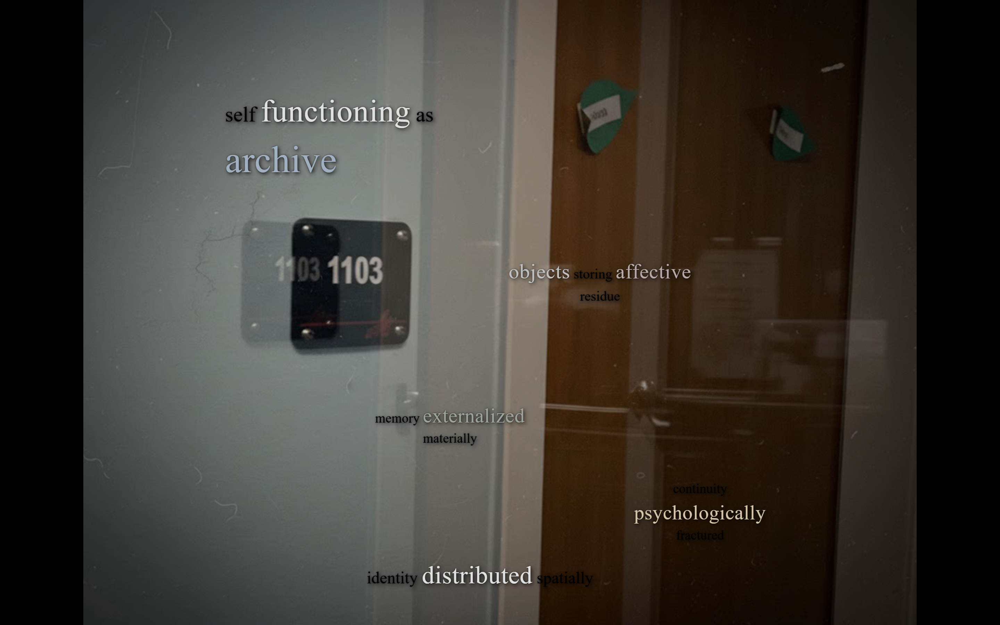

# Phase 2: Beta Advanced Hypertext & Typographic Kernels

The advanced evolution of the *Pain and Memory* hypermedia system completed for **COM 256: Interactive Web Design** at Muhlenberg College. This phase refines the spatial imagery into high-resolution fixed-stage viewports and transitions from boxed containers into ethereal, typography-first text kernels.

  

## What I Built

- **Fixed-Stage High-Resolution Imagery (`image/`)**: A centered 1200×900 viewport stage (`.stage`) hosting high-resolution 3600×2700 photography. Image maps feature calibrated polygonal hot spots that link directly across both Alpha and Beta spaces.
- **Atmospheric Textual Overlays (`imagine/`)**: Ten refined spatial pages pairing full-bleed responsive background photography with high-contrast text kernels and localized gradient illumination.
- **Floating Typographic Kernel System (`text/`)**: A typography-driven stylesheet ([`beta-text-design.css`](file:///c:/Users/RobTop/Downloads/project%20-%20kohn%20robbie-20261001T003143Z-1-001/project%20-%20kohn%20robbie/github-html-coursework/beta/text/beta-text-design.css)) that completely eliminates box-like containers. Text phrases float directly over dark backgrounds with subtle text shadows, typographic weight hierarchies, and a curated six-tone chromatic scale.
- **Thematic Chapter Organization**: Structured into ten interconnected psychological and philosophical reflections:
  1. `archive_self.html`: The human subject functioning as an archive of past attachment
  2. `caregiving_labor.html`: Vulnerability, relational exposure, and care under duress
  3. `endurance_survival.html`: Psychological survival through sustained grief
  4. `ethical_repetition.html`: Repetition as moral obligation and prolonged empathy
  5. `friendship_decay.html`: Entropy and communicative silence in broken relationships
  6. `memory_tyranny.html`: The oppressive persistence of involuntary recall
  7. `pain_expression.html`: The difficulty and inadequacy of linguistic expression for internal pain
  8. `relational_pain.html`: Trauma transmitted relationally between individuals
  9. `sensory_memory.html`: Physical artifacts retaining emotional residue
  10. `temporal_dissonance.html`: Past events distorting the perception of present time

## Technologies

- **HTML5**: Semantic tags, absolute spatial coordinates, hyperlink graph routing.
- **CSS3**: Stage centering, fluid clamp sizing, multi-tier text shadows (`2px 2px 6px rgba(0,0,0,0.8)`), custom typographic emphasis utilities, and smooth CSS transitions.
- **JavaScript & jQuery**: jQuery 1.10.2 and `jquery.rwdImageMaps` for dynamic polygonal area recalculation.

## Files

- [`image/`](file:///c:/Users/RobTop/Downloads/project%20-%20kohn%20robbie-20261001T003143Z-1-001/project%20-%20kohn%20robbie/github-html-coursework/beta/image/): Ten high-resolution image map pages (`1103.html` through `tf.html`).
- [`image/media/`](file:///c:/Users/RobTop/Downloads/project%20-%20kohn%20robbie-20261001T003143Z-1-001/project%20-%20kohn%20robbie/github-html-coursework/beta/image/media/): High-resolution 3600×2700 photography.
- [`imagine/`](file:///c:/Users/RobTop/Downloads/project%20-%20kohn%20robbie-20261001T003143Z-1-001/project%20-%20kohn%20robbie/github-html-coursework/beta/imagine/): Ten image-anchored text kernel pages with clean navigation return pathways.
- [`text/`](file:///c:/Users/RobTop/Downloads/project%20-%20kohn%20robbie-20261001T003143Z-1-001/project%20-%20kohn%20robbie/github-html-coursework/beta/text/): Ten typography-driven chapter pages and [`beta-text-design.css`](file:///c:/Users/RobTop/Downloads/project%20-%20kohn%20robbie-20261001T003143Z-1-001/project%20-%20kohn%20robbie/github-html-coursework/beta/text/beta-text-design.css).

## Features

- **Typography-First Design System**:
  - Base kernel text with subtle drop-shadows for legibility without solid background boxes.
  - Multi-tier emphasis classes: `.emph` (150% scaling, 0.5px letter-spacing) and `.emph-more` (180% scaling, 300 weight).
  - Cohesive muted color palette: off-white (`.color-1`), silver (`.color-2`), dusty blue (`.color-3`), muted rose (`.color-4`), sage (`.color-5`), and warm sand (`.color-6`).
- **Stage Isolation**: Restricts viewport distortion by constraining the spatial canvas to a 1200×900 aspect ratio while scaling high-resolution assets internally.

## What I Learned

- How to balance graphic density with text legibility without relying on opaque card backgrounds.
- Designing expressive typographic hierarchies within short, fragmented micro-copy.
- Cross-quadrant hypermedia architecture: balancing outbound links so that visual nodes seamlessly hand off to philosophical text nodes.

## Running Locally

Open any of the chapter files directly in a web browser:
- Starting Chapter: [`text/archive_self.html`](file:///c:/Users/RobTop/Downloads/project%20-%20kohn%20robbie-20261001T003143Z-1-001/project%20-%20kohn%20robbie/github-html-coursework/beta/text/archive_self.html)
- First Image Node: [`image/1103.html`](file:///c:/Users/RobTop/Downloads/project%20-%20kohn%20robbie-20261001T003143Z-1-001/project%20-%20kohn%20robbie/github-html-coursework/beta/image/1103.html)
- First Overlay Node: [`imagine/1103.html`](file:///c:/Users/RobTop/Downloads/project%20-%20kohn%20robbie-20261001T003143Z-1-001/project%20-%20kohn%20robbie/github-html-coursework/beta/imagine/1103.html)

No local server or build tools are required.
